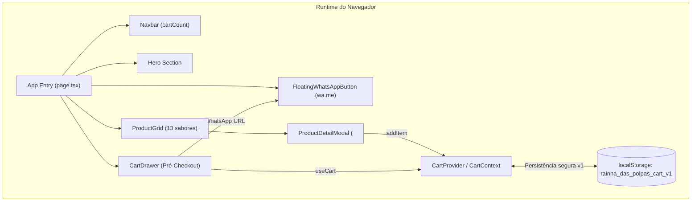

# Arquitetura As-Is — Rainha das Polpas

Data da Revisão: **31/10/2026**. Fonte: Código em produção em `src/`.

---

## 1. Visão de Componentes e Runtime Atual

Atualmente, o storefront opera como uma Single Page Application / Static Site pré-compilada, servida a partir de borda Cloudflare Pages.

## 2. Invariantes Comprovadas
- Catálogo de 13 sabores estáticos em `src/data/products.ts`.
- Persistência desacoplada em `localStorage` contendo apenas identificadores e quantidades.
- Canal único `5588997099082` garantido por testes de contrato em toda a interface.
- Ausência total de credenciais privadas ou segredos no bundle do cliente.
