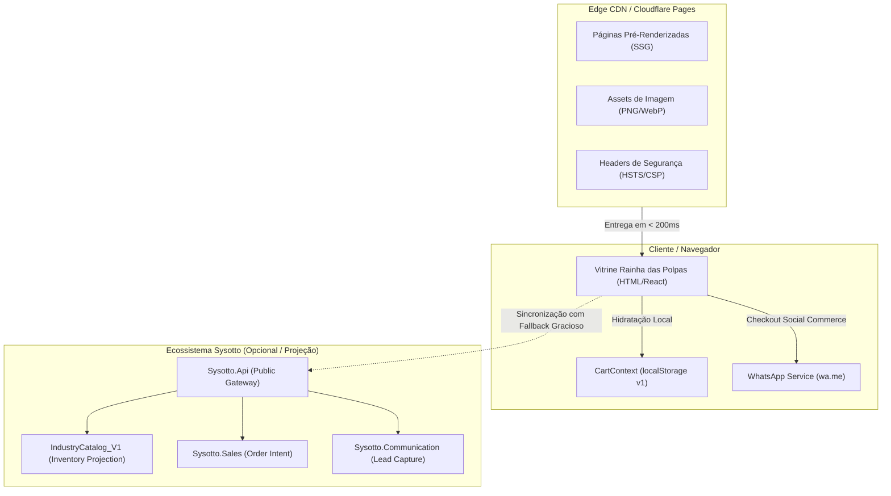
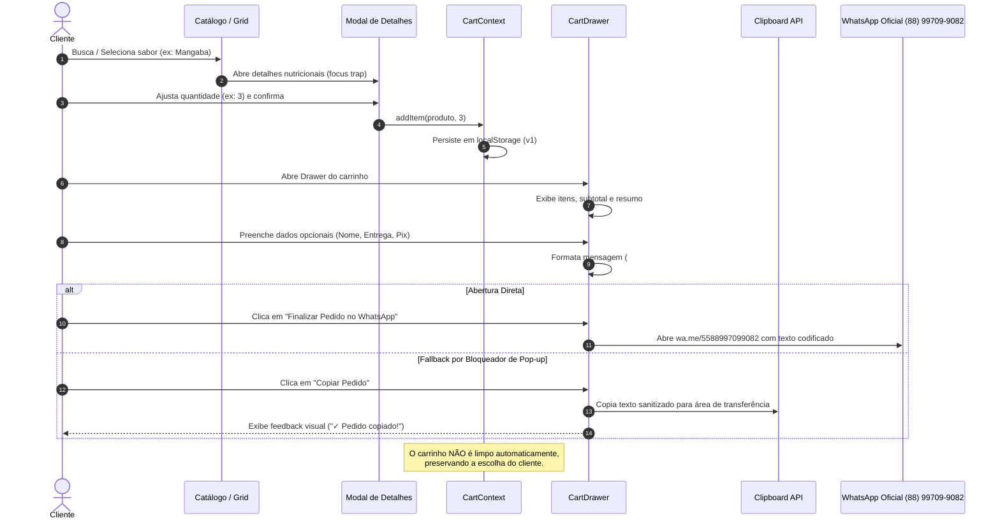

# Decisões de Design e Arquitetura — Rainha das Polpas

ID: `DESIGN-RP-001`. Estado: **aprovado**. Módulo: `Rainha das Polpas (Storefront D2C)`.

Este documento registra as decisões de design arquitetural, stack tecnológica, fluxos de checkout e integrações em conformidade com o padrão `DOC-MOD-001`.

---

## 1. Stack Tecnológica e Decisões Fundamentais

| Camada | Tecnologia Adotada | Justificativa |
| :--- | :--- | :--- |
| **Framework Web** | Next.js 16 (App Router / SSG) | Compilação estática (`output: 'export'`) gerando HTML/JS imutável para carregamento instantâneo em CDN. |
| **Biblioteca de UI** | React 19 | Renderização reativa com Context API (`CartContext`) e gerenciamento determinístico de efeitos. |
| **Estilização** | Tailwind CSS v4 | Design tokens pré-processados pelo `@tailwindcss/postcss`, utilitários acessíveis e suporte nativo a `motion-reduce`. |
| **Linguagem** | TypeScript 5.x | Tipagem estrita ponta a ponta garantindo contratos seguros com o ecossistema Sysotto. |
| **Testes Unitários & DOM** | Node.js Test Runner + JSDOM | Execução ultra-rápida sem dependência pesada de frameworks externos complexos. |
| **Testes End-to-End** | Playwright | Validação de jornadas reais de checkout em navegadores Desktop e emuladores Mobile. |
| **Distribuição / Edge** | Cloudflare Pages | Hospedagem em borda com headers de segurança (`Content-Security-Policy`, `X-Frame-Options`, `HSTS`). |

---

## 2. Diagrama de Arquitetura Jamstack

O storefront adota uma arquitetura Jamstack desacoplada, servida diretamente a partir de nós de borda (Edge CDN), combinando um catálogo local estático garantido com portas de sincronização para a API pública do Sysotto.

---

## 3. Diagrama do Fluxo de Compra e Checkout WhatsApp

O fluxo de compra é centrado na experiência do usuário, sem atritos de cadastro prévio ou etapas de pagamento desnecessárias, direcionando o fechamento diretamente ao canal comercial oficial.

---

## 4. Decisões de Integração e Segurança

1. **Canal Oficial Único (`WHATSAPP_NUMBER`)**:
   - Centralizado estritamente em `5588997099082`. Qualquer outro número em código ou documentação é considerado não conformidade grave.
2. **Proibição Absoluta do Header `X-Tenant-Id` (`IND-005`)**:
   - As requisições públicas anônimas usam exclusivamente o `siteSlug` (`rainhadaspolpas`) na rota da URL. Não há passagem nem leitura de cabeçalho de tenant no cliente.
3. **Resiliência e Fallback Gracioso na Leitura**:
   - O site não depende de backend ativo para funcionar. Em caso de queda, timeout ou ausência de rede, `src/data/products.ts` garante a apresentação completa dos 13 sabores.
4. **Segurança de Segredos**:
   - Nenhuma chave privada ou credencial de API é empacotada no bundle do cliente. Apenas variáveis públicas `NEXT_PUBLIC_*` são expostas.
