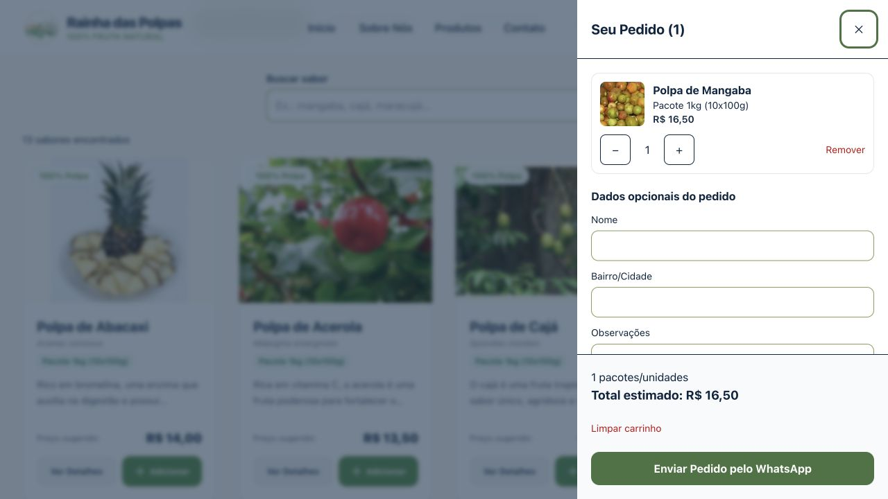

# Catálogo e carrinho — issues 6 e 7

Implementado em 29/10/2026 no repositório `OttoF77/rainha-das-polpas`.

- #6: grid de 13 sabores, busca por nome sem distinção de acentos/caixa, filtros combinados, estado vazio, imagens responsivas e modal com quantidade, benefícios e conservação.
- #7: CartProvider/useCart, drawer com miniaturas e controles acessíveis, quantidades inteiras de 1 a 999, remoção ao decrementar de 1, total em BRL ou Sob consulta e dados opcionais para o resumo do pedido.
- Persistência: chave `rainha_das_polpas_cart_v1`, schema versão 1; somente identidade e quantidade são armazenadas. Preços e demais dados são reconstruídos a partir do catálogo atual. Payloads inválidos e storage bloqueado não interrompem o carrinho.
- Acessibilidade: dialog nativo modal, foco contido, Esc, retorno ao acionador, anúncio aria-live e animações respeitando movimento reduzido.

## Validação

- `npm test`: 11 testes aprovados, incluindo operações do carrinho, totais mistos/preço zero, payloads inválidos, restauração, armazenamento indisponível, busca e interação dos componentes.
- `npm run typecheck`, `npm run lint` e `npm run build`: aprovados; exportação estática gerada em `out/`.
- Build inspecionado no navegador: busca por Mangaba, abertura do modal, ciclo de foco com Shift+Tab, inclusão do produto, restauração após recarregar, drawer com preço e miniatura, Esc e retorno do foco ao botão do carrinho.
- Testes DOM usam adaptador de next/image e simulação do dialog; o comportamento nativo de foco foi conferido separadamente no navegador.

## Dependências de conteúdo

O dataset não contém valores nutricionais quantitativos confirmados. A tabela usa “Consultar rótulo” até o fabricante fornecê-los. Benefícios e descrições existentes foram preservados. Não há link de protótipo Figma aprovado em `design/README.md`; a implementação preserva a identidade visual existente. A inspeção visual foi desktop; homologação em aparelhos móveis permanece pendente.

Implementação validada localmente. A regra de preços regionais após login está planejada separadamente na issue #11.
